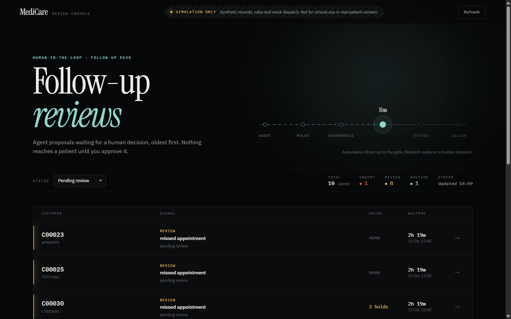
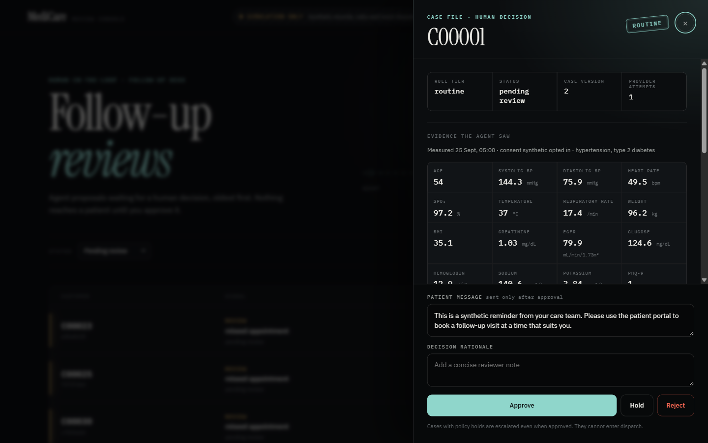
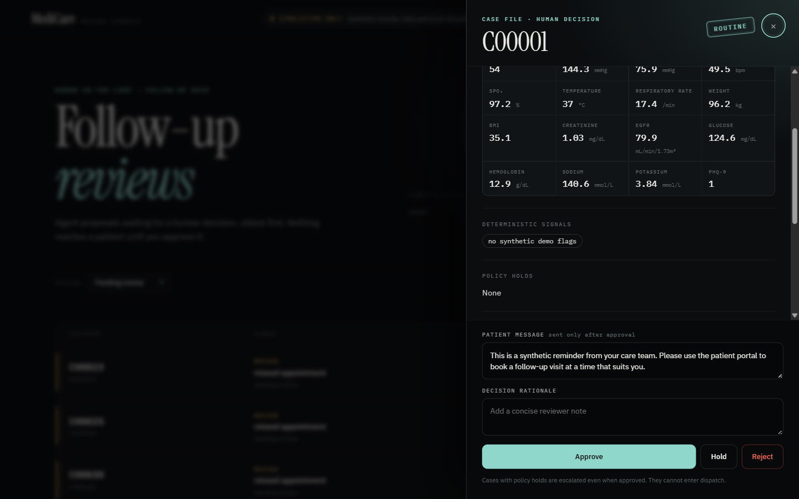
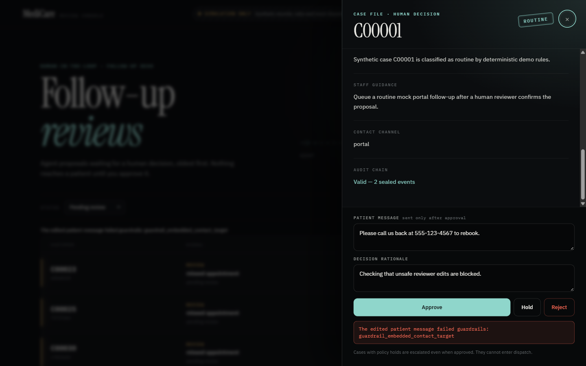
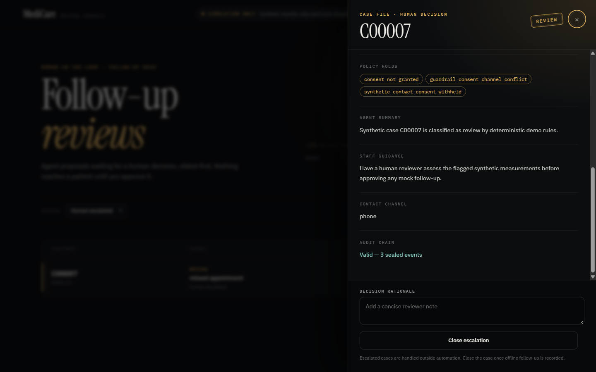
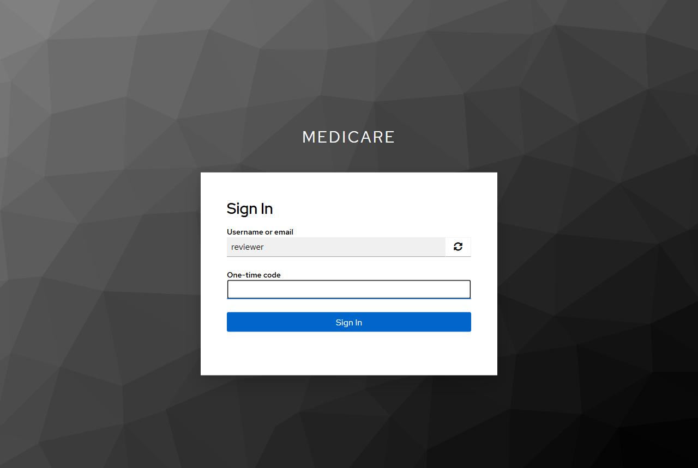
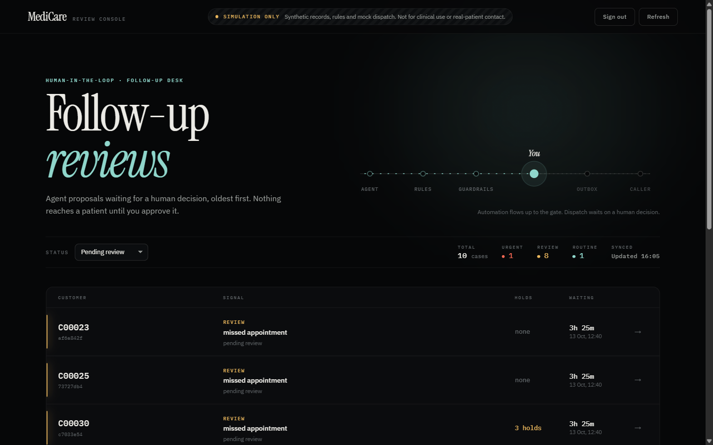

# MediCare Agent Platform

A synthetic-only follow-up workflow with automated case preparation and mandatory human review.

The worker calls the agent API over HTTP. The API applies deterministic safety rules, calls a separate model-gateway service, runs deterministic output guardrails, and places the proposal in a reviewer queue. Nothing reaches the caller service until a human approves the case.

> This is an engineering demonstration, not a clinical system. It is not approved for real patient data, diagnosis, treatment decisions or patient contact. The runtime rejects real-data and live-dispatch modes.

## Flow

```text
automation worker -> agent API -> model gateway
                         |               |
                  deterministic <-------'
                    guardrails
                         |
                    human review
                         |
                 transactional outbox
                         |
              authenticated caller service
```

The model drafts a bounded proposal. Deterministic code owns the risk tier, consent gate, output guardrails, review transition, audit trail and dispatch decision.

## Included

- 10,000 reproducible synthetic customers and 15 measurements per customer.
- FastAPI control plane and separate HTTP model gateway.
- Mandatory approve, hold or reject review with stale-write protection; held cases can be
  re-reviewed and escalated cases are closed with a recorded rationale.
- Reviewers see the exact evidence the agent saw and approve the patient-facing message, which
  is separate from staff guidance and re-checked by guardrails when edited.
- Versioned consent evidence and non-bypassable safety holds.
- Idempotent case creation, transactional outbox with lease recovery and a separate authenticated
  caller service.
- Automatic recovery of stuck model runs and bounded, backed-off provider retries.
- Keyed (HMAC-SHA256), sealed audit chains that detect edits, forks and truncation.
- Local reviewer keys plus production OIDC (authorization code + PKCE) with scope and MFA
  enforcement.
- File-mounted secrets and overlapping service-key rotation.
- PostgreSQL/SQLite, Alembic, Docker Compose and non-root containers.
- Protected Prometheus metrics, alert rules and worker heartbeats.
- Retention, release-gate, backup/restore and load-test tooling.

The generated measurements are blood pressure, heart rate, oxygen saturation, temperature, respiratory rate, weight, BMI, creatinine, eGFR, glucose, hemoglobin, sodium, potassium and PHQ-9.

## Reviewer console

The console is a near-black editorial interface with one accent at a time: the accent is the risk
tier of the case in view (sea-glass routine, amber review, signal-red urgent), so colour always tells
the reviewer what they are looking at. The opening frame shows the pipeline itself: automation flows
up to a glowing human gate and the outbox and caller stay dark until a decision is made. The queue is
oldest first and paginated; each case opens as a tier-stamped case file with the evidence, guardrail
holds, proposal and decision controls. Fonts are self-hosted (SIL OFL), the layout works down to
phone width, and every animation is disabled under `prefers-reduced-motion`. Screenshots were
captured on 2026-10-13 from a local run against the real API, model gateway and seeded 10,000-row
synthetic dataset.

**Review queue.** Pending cases, oldest first, with each case's tier rail, rule signal, hold count and time waiting.



**Case file.** Tier stamp, status, version and provider attempts, then the decision form. The
patient message is pre-filled from the proposal and is the only text that can leave the system.



**Evidence the agent saw.** The stored snapshot of all 15 synthetic measurements, so a reviewer is
not approving blind.



**Guardrails on reviewer edits.** An edited message containing a phone number is rejected with the
failing check shown inside the drawer. The audit chain status shows a valid, sealed chain.



**Escalated cases.** Cases with policy holds (here: consent withheld) never enter dispatch. The
only action is to close them once offline follow-up is recorded.



**Organization sign-in (OIDC + MFA).** In OIDC mode the console uses the authorization-code flow
with PKCE. Verified against a real Keycloak 26.0.7 identity provider: password, then a TOTP second
factor, then back to the console with an access token that the API validates against the IdP's
JWKS (issuer, audience, `medicare:review` scope and `amr: ["mfa"]`). A password-only token was
refused with `403 Reviewer MFA claim is required`. Setup steps are in
[Verification](docs/VERIFICATION.md#identity-provider-login-keycloak).





## Local run

Requirements: Python 3.12–3.14 and `uv`.

```powershell
cd D:\Interview\Sapient\medicare-agent-platform
Copy-Item .env.example .env
uv sync --all-extras
uv run python scripts/generate_synthetic_data.py
uv run alembic upgrade head
uv run medicare bootstrap --csv data/synthetic_customers.csv
```

Start the gateway:

```powershell
uv run uvicorn services.model_gateway.main:app --host 127.0.0.1 --port 8091
```

Start the caller service in another terminal:

```powershell
uv run uvicorn services.caller.main:app --host 127.0.0.1 --port 8092
```

Start the API in another terminal:

```powershell
uv run uvicorn medicare_agent.main:app --host 127.0.0.1 --port 8000
```

Run one automated batch through the service boundary:

```powershell
uv run python -m medicare_agent.worker automation --once
```

Open `http://127.0.0.1:8000`, use the reviewer token from `REVIEWER_API_KEYS`, inspect a case and record a decision. Drain approved caller events with:

```powershell
uv run python -m medicare_agent.worker dispatch --once
```

Each automation tick also calls `POST /api/v1/agent/maintenance`, which fails model runs stuck in
`provider_pending` and returns failed runs whose retry backoff has elapsed; the worker then retries
them. Customers are marked when their first case is created, so retention never makes them eligible
for automated contact again.

## Containers

```powershell
docker compose up --build
```

This starts PostgreSQL, migration/bootstrap, model gateway, caller service, API and both workers. The dashboard is available at `http://127.0.0.1:8000`.

The production override removes inline application secrets and requires OIDC (including the
browser client settings), HTTPS, explicit hosts, a file-mounted audit key, the reverse-proxy address
in `FORWARDED_ALLOW_IPS` and an approved release manifest. Probes, `/metrics` and the service-key
worker routes stay reachable over plain HTTP on the internal network; browser-facing routes require
HTTPS as reported by the trusted proxy:

```powershell
docker compose -f compose.yaml -f compose.production.yaml config
```

Secret names and required release evidence are documented in [Release gates](docs/RELEASE_GATES.md). The override is a deployment contract, not proof that an organization has supplied those approvals.

## Model gateway

The default `MODEL_GATEWAY_MODE=stub` exercises the real HTTP path without an external provider. To use the OpenAI adapter, configure only the gateway:

```env
MODEL_GATEWAY_MODE=openai
OPENAI_API_KEY_FILE=/run/secrets/openai_api_key
OPENAI_MODEL=gpt-5-mini
OPENAI_TIMEOUT_SECONDS=30
```

Keep the API's `MODEL_GATEWAY_TIMEOUT_SECONDS` above `OPENAI_TIMEOUT_SECONDS` so the API never
abandons a live model call. The gateway replays the first response for a repeated
`Idempotency-Key`, so client retries are not billed twice. The structured-output schema drops
length and title keywords (Pydantic re-validates them) to stay inside the strict-mode subset. The
response is validated again before reaching the workflow. External provider access was not used as
evidence for this repository.

## Caller integration

The included caller runs in `mock` mode and proves the complete approval-to-service path without contacting a person. To connect an owned voice service, keep the internal caller credential separate and configure the caller container with:

```env
CALLER_MODE=http
CALLER_PROVIDER_URL=https://voice.example.com/v1/calls
CALLER_PROVIDER_API_KEY_FILE=/run/secrets/caller_provider_api_key
CALLER_PROVIDER_IS_SYNTHETIC_SANDBOX=true
```

HTTP mode refuses to start unless the operator attests that the provider is a synthetic sandbox;
live patient dispatch is not approved.

The external service must accept the `CallerRequest` JSON contract and return `external_id`, `status: accepted` and `provider`. The caller forwards the outbox event ID as `Idempotency-Key`. A provider error returns `502`; the dispatch worker retries transient failures with bounded exponential backoff, dead-letters permanent `4xx` rejections immediately and dead-letters retries after the configured attempt limit. Events whose dispatcher died mid-call are reclaimed after `OUTBOX_LEASE_SECONDS`. Real phone numbers are deliberately absent, and the runtime still permits synthetic records only.

## Operations

```powershell
# Status and audit
uv run medicare stats
uv run medicare verify-audit <case-id>

# Recover stuck runs / retry one failed model run
uv run medicare maintenance
uv run medicare retry-case <case-id>

# Preview retention; --execute is deliberately explicit
uv run medicare retention-sweep
uv run medicare retention-sweep --execute

# Validate a release manifest and its pinned digest
uv run medicare release-gate --manifest approvals.json --environment production --sha256 <digest>

# Local SQLite backup and integrity check
uv run python scripts/sqlite_backup.py --source data/medicare.db --output output/backups/medicare.db

# PostgreSQL logical backup and isolated restore drill
powershell -File scripts/postgres_backup_restore_drill.ps1
```

Prometheus and Alertmanager definitions are under `ops/`. Production alert routing must point to an organization-owned incident channel; the checked-in Alertmanager receiver is intentionally a local visible sink.

## Checks

```powershell
uv lock --check
uv run ruff format --check .
uv run ruff check .
uv run mypy src services scripts
uv run pytest --cov --cov-report=term-missing
uv run python scripts/generate_synthetic_data.py --validate-only
$env:DATABASE_URL = "sqlite:///./ci-migrations.db"
uv run alembic upgrade head
uv run alembic check
uv run pip-audit -r audit-requirements.txt
docker compose config --quiet
```

The executed results and remaining external approvals are recorded in [Verification](docs/VERIFICATION.md).

### Latest verification (2026-10-13)

| Check | Result |
|---|---|
| `pytest --cov` (SQLite) | 134 passed; 100% statement and branch coverage across `medicare_agent` and `services` |
| `pytest` with `TEST_DATABASE_URL` on PostgreSQL 17.11 | 133 passed, 1 skipped (needs SQLite's switchable check constraint) |
| `ruff format --check`, `ruff check`, strict `mypy` | Passed |
| `alembic upgrade head` → `alembic check` → `downgrade base` → `upgrade head` | No model/migration drift; round trip clean on SQLite and PostgreSQL |
| `0002` → `0003` upgrade on a database with legacy rows | Follow-up markers, attempt counts, patient messages and legacy audit hash version backfilled on SQLite and PostgreSQL |
| Base and production `docker compose config` | Both valid |
| `docker compose up --build` on PostgreSQL with `ENFORCE_HTTPS=true` | Images built; every service healthy; containers run as uid 10001; automation created 240 cases with no errors; a review then dispatched through the containerised caller (`delivered`, sealed audit chain); `/` over plain HTTP returned `400` |
| `pip-audit` on the locked dependencies | No known vulnerabilities found |
| Real OIDC login (Keycloak 26.0.7, PKCE, TOTP) | Password-only token refused (`403`); password + TOTP token accepted; review recorded under the Keycloak subject |
| Seed of the full 10,000-row CSV with row validation | 10,000 seeded |
| Live services with `ENFORCE_HTTPS=true` | Probes, metrics and workers work over internal HTTP; `/` returns `400`; a spoofed `X-Forwarded-Proto` from an untrusted client returns `400` |
| Live gateway outage, then recovery | 3 runs failed, then were retried to `pending_review` by the next automation tick |
| Live review and dispatch | Unsafe edited message rejected (`422`); approved edited message is the text delivered to the caller; audit chain valid and sealed |
| Live retention sweep of a dispatched case | Customer marker kept; no new case created; sweep recorded in the audit log |
| Reviewer console in Chromium | Screenshots above; no console errors or accessibility warnings |

## Documentation

- [Architecture](docs/ARCHITECTURE.md)
- [Security](docs/SECURITY.md)
- [Operations](docs/OPERATIONS.md)
- [Release gates](docs/RELEASE_GATES.md)
- [Data dictionary](docs/DATA_DICTIONARY.md)

Clinical approval, legal/privacy approval, provider contracts and permission for real-patient use cannot be granted by code. Production startup requires structured evidence for the applicable organizational gates, while real-patient data and live dispatch remain hard-disabled in this build.
